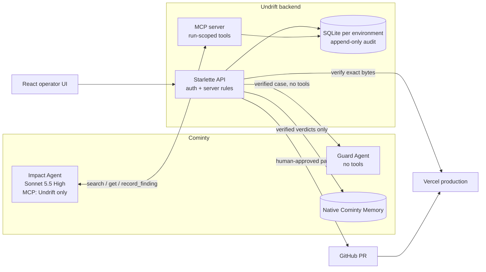

# Undrift

**One policy changes. Undrift finds drift across customer channels, asks for missing facts, prepares controlled fixes and verifies published corrections.**

When a company changes a policy, the old version lives on in help-center articles, chatbot knowledge, support macros, order e-mails, CRM notes and legal pages. Customers get contradictory answers, and some "outdated" statements are actually protected promises that must not be touched. Undrift lets Cominty Managed Agents do the reasoning across every channel, while the server enforces evidence, permissions and human authority.

**Public jury demo (read-only):** https://undrift-jury-demo.equalglass4.chatgpt.site

The demo scenario is Shiftly, a fictional storefront. It shortens voluntary returns from **60 to 30 days** for purchases from 4 November 2026. Earlier promises and the statutory 14-day withdrawal right remain valid.

## What it does

| Step | What happens | Evidence |
|---|---|---|
| Discover | The **Cominty Impact Agent** searches 24 documents in seven channels through Undrift's MCP server and records evidence-backed findings (outdated, still valid, existing commitment, unrelated, unknown). | Real Cominty runs |
| Clarify | When a fact is missing (for example an order's purchase date), the agent asks **native Cominty clarification questions**. A reviewer answers, and the **same thread continues**. | 5 genuine questions and answers |
| Review | Each correction is an **exact patch** with a diff, the verbatim original evidence and the policy version it is based on. The server re-validates document version, policy version and guardrails before anything changes. | Persisted audit trail |
| Autonomy | Every channel has its own **server-enforced** mode: `manual_only` (legal, CRM), `review_required`, `pull_request` (website) or `bounded_auto` (at most N verified changes per run, with receipts). | Recorded delegation and audit |
| Publish | An approved website patch becomes a **GitHub pull request**. A human merges it, Vercel deploys, and Undrift **verifies production** serves exactly the approved bytes. | [PR #1](https://github.com/danielsamo-se/shiftly-storefront/pull/1), commit `c391b36`, [live page](https://shiftly-storefront.vercel.app/returns/) |
| Guard | A **separate Cominty Managed Agent with no tools** validates outgoing replies against strict versioned contracts. The server checks every binding and fails closed. | One live ALLOW, server-verified |
| Memory | Verified interpretations are stored in **native Cominty Memory**, bound to the policy version. They are recalled later but can never decide or release anything. | File read back independently from Cominty |
| Evaluate | A frozen **five-trial reliability study**, failures included. | `evaluations/reliability-v2-*` |

## Architecture



- **Cominty Managed Agents do all AI reasoning.** No other LLM API is used.
  - The **Impact Agent** (`agents/impact.md`) reaches Undrift only through one custom MCP integration with seven tools: `list_channels`, `get_policy`, `search_documents`, `similar_documents`, `get_document`, `record_finding` and `health_check`. Run credentials are scoped to one analysis run.
  - The **Guard Agent** (`agents/guard.md`) has every capability disabled. Undrift sends it a verified case and checks its JSON verdict (`guard.py`).
- **Native platform features:** clarification questions and same-thread continuation (`clarification.py`), Cominty Memory (`integrations.py`), and per-run capability restriction and cost reporting.
- **The backend is the authority.**
  - Findings must quote stored evidence verbatim.
  - Proposals are pinned to document and policy versions.
  - Approvals need a reviewer token.
  - Channel autonomy, Guard decisions and memory eligibility are decided on the server, never by an agent or the browser.

## Human review and autonomy boundaries

- Agents can only *propose*. Applying a change requires either a reviewer, or explicit per-channel delegation that is pinned to the run that produced the proposal.
- Legal and CRM are always `manual_only`. The website only moves through a human-merged pull request.
- Guard combines its verdict fail-closed: the most restrictive result wins.
  - A deterministic precheck can only escalate.
  - Missing configuration, timeouts, malformed or contradictory output, and policy or evidence changes during a check all result in `NEEDS_REVIEW` or `BLOCK`.
  - Only a server-verified real Cominty `ALLOW` is release-eligible.
- Memory stores only server-verified Cominty verdicts and reviewer-confirmed facts. Entries from older policy versions are shown as historical.
- Slack notifications are prepared but **not connected**. When connected, Slack is a notification channel only and never an approval path.

## Evaluation (Reliability v2, frozen)

Five independent paid conversations against the unchanged Impact Agent: 8 messages, 3.28553740 platform units, no retries.

| Result | Value |
|---|---|
| Reconciled trials | 3 of 5, each with **100%** classification accuracy |
| Failed trials | 2 of 5 failed the frozen search-order contract and get zero credit |
| Primary accuracy (mean, failures included) | **60%** |
| Native clarification questions captured | 25 of 25 (precision and recall 1.0) |
| Observed false positives | 0 |

This is a small study on one scenario. It shows the system's safety behaviour and a real failure mode (search-order compliance), not universal production reliability. The full report is in `evaluations/reliability-v2-report.md`, and the archived failed first study is in `evaluations/reliability-v1-*`.

**Agent configuration fingerprint.** The live Impact Agent still matches the configuration the study evaluated:
- normalized instructions `ed03b7f2…`;
- capabilities `f916301b…`;
- model Claude Sonnet 5.5 (High);
- MCP tool code unchanged since commit `f0c3379`.

## Public demo

The jury site is a read-only Cloudflare Worker. It serves immutable projections exported through Undrift's own API from the original databases (`jury.py`, `deployment/jury/worker.mjs`, `docs/PUBLIC_DEMO.md`).
- Each archive keeps its own database identity and run IDs, so independent executions are never merged.
- Every step is labelled as a real Cominty execution, a human decision, GitHub/Vercel production, a server rule, a frozen evaluation or a **local test fixture**.
- The site accepts only GET and HEAD. It has no tokens, no agent credentials, no database and no writable route.

**Limitations of the public demo:**
- No agent runs from the public site.
- Automatic channel application is shown with a clearly labelled local fixture.
- The Guard agent has one recorded live check.
- The stored Cominty Memory file contains a known redaction defect, so only its verified metadata is shown.

## Security model

- **Secrets:** they live only in `.env`, which is git-ignored. The MCP endpoint uses a rotating path secret, and reviewer actions require a bearer token compared with HMAC.
- **Write path:** every write is authenticated and validated on the server, and every action is recorded in an append-only audit trail with immutability triggers on the Guard and integration journals.
- **Data protection:** historical evaluation databases are never migrated. Schema upgrades are explicit opt-ins, and exports redact credentials and personal data.
- **Paid actions:** paid Cominty executions need explicit per-request confirmation, and agents are created only by scripts that refuse to run without `--apply`.

## Local setup

The steps are in [SETUP.md](SETUP.md): Python 3.13 virtual environment, MCP tunnel, Cominty integration and agent IDs. Quick checks:

```powershell
.\.venv\Scripts\python.exe -m pytest -q          # backend suite
cd ui; ..\.tools\node\node.exe node_modules/vitest/vitest.mjs run   # frontend suite
.\.venv\Scripts\python.exe scripts\guard_agent.py plan             # local only, no network
```

Further documentation:
- [Discovery](docs/DISCOVERY.md)
- [Clarification](docs/CLARIFICATION.md)
- [Publishing](docs/PUBLISHING.md)
- [Reliability v2](docs/RELIABILITY_V2.md)
- [Public demo](docs/PUBLIC_DEMO.md)
- [Submission and demo script](docs/SUBMISSION.md)

## Repository layout

```
api.py, server.py      Starlette API and MCP server
workflow.py, store.py  domain rules, versioned SQLite store, audit
discovery*.py, clarification*.py, autonomy*.py, guard.py, integrations.py, publishing.py
agents/                Managed Agent instructions (Impact, Guard, prepared Notifier)
evaluations/           frozen protocols, results and reports
ui/                    React 19 + TypeScript operator and jury interface
shiftly/               the fictional storefront that receives the PR
deployment/jury/       read-only public Worker and deployment record
```
